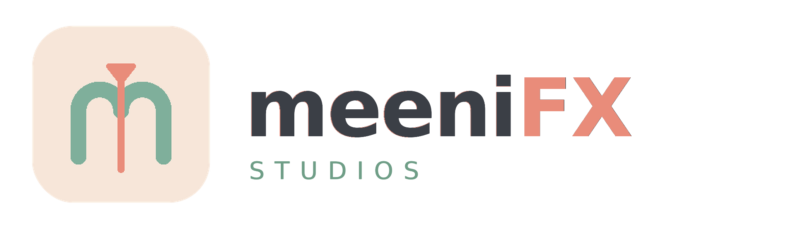
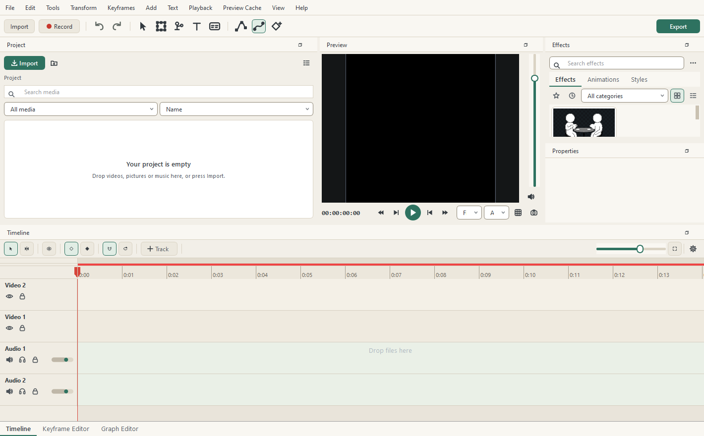

<p align="center">
  
</p>

<p align="center">
  <strong>A friendly, creative video editor for Windows.</strong>
</p>



## Download

**meeniFX Studios is in Alpha.** It is usable and tested, but unfinished, and some features
are still experimental.

[**Download meeniFX Studios 0.1.0-alpha.4 →**](https://github.com/meeniDev/meeniFX/releases/tag/v0.1.0-alpha.4)

Each published release contains:

- `meeniFX-Studios-<version>-Windows-Setup.exe` - the installer, recommended.
- `meeniFX-Studios-<version>-Windows-Portable.zip` - no installation required.
- `SHA256SUMS.txt` - checksums for both downloads.

Installed builds can update themselves from inside the app. Portable builds are updated by
replacing the extracted folder with a newer ZIP; your projects and preferences live outside
it.

**Windows only for now. Linux support is planned but not officially supported yet.**
Windows 10 or 11, 64-bit. The installed application does not require Python.

## What it does

- **A real timeline** - multiple video and audio tracks, snapping, markers, fades, linked
  video and audio, trimming, splitting and full undo/redo.
- **Effects that look the same in the export** - colour correction, blurs, glow, stylize,
  glitch and warp effects, keying, LUTs and one-click Looks.
- **Rotoscoping** - a Roto Brush mode made for it: green keep and Alt-red remove strokes,
  a Refine Edge brush, a purple outline that follows the subject, a base frame, forward and
  backward propagation, correction strokes, matte previews and a freezeable mask cache.
- **Animation** - keyframes on every numeric parameter, a Keyframe Editor, a Graph Editor,
  easing families, motion paths and reusable animation presets.
- **Text and shapes** - styled, keyframeable text clips and vector shapes that stay sharp at
  any resolution.
- **Recording and captions** - webcam, screen, microphone and system audio, plus local Auto
  Captions with a transcript editor and SRT import/export.
- **Smart Paste** - paste a picture, a file, a direct media link or a YouTube link and keep
  working.
- **Export** - MP4, AVI, GIF and image sequences, whole project or loop region, with hardware
  encoding when it is genuinely faster.

The detailed reference lives in [docs/FEATURES.md](docs/FEATURES.md).

## Install

1. Open the [Releases page](https://github.com/meeniDev/meeniFX/releases).
2. Download the newest Alpha's Windows Setup executable.
3. Run it and launch **meeniFX Studios** from the Start Menu.

The installer is per user, so it does not ask for an administrator password, and it creates
an uninstaller. Upgrading keeps your projects, preferences, layouts and presets.

Full instructions, including the portable build and running from source, are in
[docs/GETTING_STARTED.md](docs/GETTING_STARTED.md).

## Documentation

- [Getting started](docs/GETTING_STARTED.md) - install, first project, export, updates.
- [Feature reference](docs/FEATURES.md) - the detailed description of what is implemented.
- [Keyboard shortcuts](docs/SHORTCUTS.md)
- [Recording](docs/RECORDING.md)
- [Effects and animations](docs/EFFECTS_AND_ANIMATIONS.md)
- [Development and packaging](docs/DEVELOPMENT.md)
- [Changelog](CHANGELOG.md)

## Project status

meeniFX Studios is under active development. Alpha builds are labeled as such in the About
box, the installer and every release, and the app checks GitHub Releases for newer Alpha
builds in the background. Updates are downloaded to a temporary folder, verified against the
release's SHA-256 checksum, and installed only after you confirm; there is no automatic
rollback yet, and installers are not publisher-signed.

Bug reports and feature requests are welcome in
[Issues](https://github.com/meeniDev/meeniFX/issues). Please include the version from
**Help > About** and, for crashes, the log path shown in the crash dialog.

## Development

```powershell
python -m pip install -r meenifx/requirements.txt
python .\main.py
```

Python 3.10+ is required to run from source. Build and release instructions, the test
commands and the repository layout are in [docs/DEVELOPMENT.md](docs/DEVELOPMENT.md).

The application version is defined once, in `meenifx/version.py`, and the Windows executable
metadata and installer version are generated from it.
