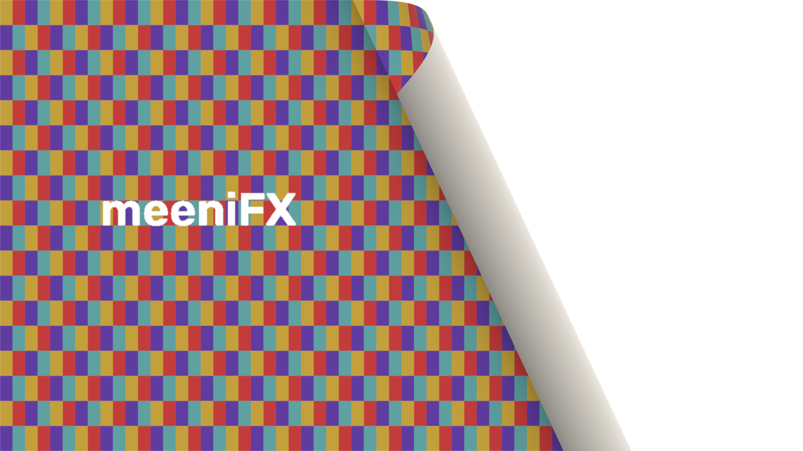
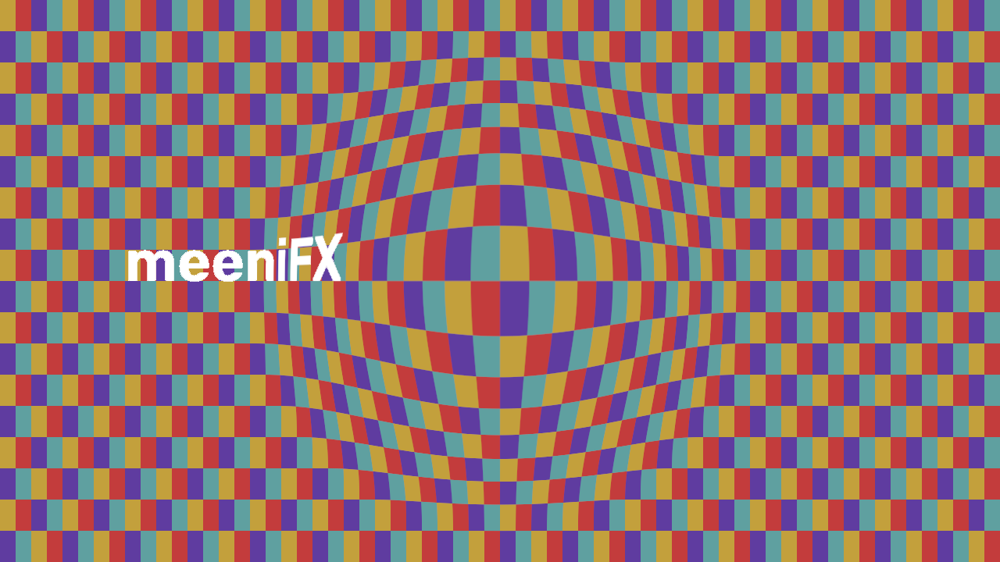

# Phase 1 shader architecture

## Existing pipeline audit

Baseline: e94997b, preserving the stabilization work. Registry: `EditorEngine.EFFECT_TYPES`.
Effects publish `ParamSpec` controls backed by `Value`; the engine evaluates stored
`AnimatedValue` parameters at clip-local frame time before `apply_effects_layer`.
`render_frame` is shared by preview and all exports. Frames are uint8 BGR or straight
BGRA in the existing display-referred sRGB working space. Mix uses the existing alpha-aware
layer mixer. Masks, adjustment layers and compositions surround this same effect path.
Looks use stable `effect_id` entries; keyframe channels address effect instances/parameters,
not translated display names. Existing JSON Looks can contain a one-effect editable stack.
The PyInstaller spec bundles assets, Looks and presets explicitly.

Existing Lens Distortion and Bulge/Pinch remain separate working effects. Kaleidoscope,
Chromatic Aberration and the glow/color/generator families also already exist. No shipped
effect or preset uses a branded prefix. Keep every existing internal ID unchanged.

## Design

A single dedicated worker owns a lazy ModernGL standalone OpenGL 3.3 context (WGL on
Windows), cached programs/VAOs, reusable float textures and one framebuffer size. Context
creation, compilation, draw, readback and destruction all occur on that worker. The render
worker waits on a bounded submission; the GUI thread does not create or compile GL objects.
Only shipped, allowlisted GLSL resources are executable. There is no downloaded shader API.

Inputs are decoded from sRGB to linear light and premultiplied before filtering. Results
are unpremultiplied, encoded back to sRGB and returned as straight BGRA. Texture row zero
and shader coordinates correspond to the top row of the input array, despite OpenGL's
framebuffer origin. `iResolution` is pixels; `iFrame` is clip-local integer frame;
`iTime` is that frame divided by project FPS, in seconds. Additional textures use iChannel1+.
Scalar/vector uniforms include finite float, int/bool/enum, vec2/vec3/vec4 and sampler inputs.

Page Curl and Lens Warp have original GLSL and matching NumPy CPU algorithms. Automatic
mode reports a CPU fallback when the GPU is unavailable; forced GPU mode reports an error.
The current CPU compositor requires upload/readback at each shader boundary; no claim of
an entirely GPU-resident chain is made. Existing frame cache/latest-wins preview queue and
export cancellation remain authoritative; cancellation is checked at submission boundaries.

Resource limits: bounded frame size/texture count/program count/estimated texture memory.
Trusted shaders have no unbounded loops. A hung driver cannot be safely preempted inside
OpenGL: process isolation would be required for arbitrary untrusted shaders, which are out
of scope. Context timeouts report failure without executing a different visual effect.

## Naming and compatibility

Canonical names/IDs: Page Curl (`page_curl`) and Lens Warp (`lens_warp`). Future names:
Kaleidoscope (`kaleidoscope`, already present), Light Rays (`light_rays`), Particle Studio
(`particle_studio`), Pixel Shatter (`pixel_shatter`). Names are not serialized identities.
No speculative migration renames existing IDs. Add explicit aliases at loading boundaries
only when an actually shipped legacy ID is established, preserving effect/parameter data.
Do not copy branded preset names, artwork, icons or shader implementations.

## References and scope

ModernGL and glcontext supply the GL bindings/context creation (MIT; their distributions
retain license metadata). Consulted the official ModernGL context/lifecycle/API documents:
https://moderngl.readthedocs.io/en/latest/topics/context.html
https://moderngl.readthedocs.io/en/latest/reference/context.html
No shader code is copied from external projects. Shadertoy-style uniform names are a
convention only. External effects are functional references, not branding or assets.

Future OpenFX hosting needs a separate native ABI bridge, plugin discovery, parameter and
image-buffer adapters, thread/lifecycle rules and process isolation. It is not a Python
shader loader and is not implemented here. Coldtype, particles and codec datamoshing are
future work; none is a dependency of Phase 1.

## Implemented behavior and visual samples

These are real algorithm outputs, not interface mockups. The page uses an original 2.5D
cylinder model: front and back inverse mappings, shading, thickness offset, shadow,
highlight and foreshortening. It is not a rectangular wipe or a physical 3D scene renderer.
Backside options are solid color, mirrored page, image file and a timeline clip. Clip
references are sampled at timeline time, clamped at source boundaries, with recursion
and depth guards. Non-composition source effects are not recursively applied; a composition
source renders its nested content with cycle detection. A page on an upper track reveals
existing lower tracks, reusing normal compositing rather than a second transition system.

Lens Warp has smooth localized elliptical mapping with signed bulge/pinch, aspect,
transparent/clamp/mirror boundaries, chromatic offsets and linear/nearest interpolation.
Center and radius handles use the existing transform overlay, undo and channel API.

Six existing-format effect presets set editable values: Corner Lift, Broad Turn, Top Fold,
Soft Glass, Wide View and Prism Lens. The normal Looks format can reference either ID;
no new preset directory/format or duplicate renderer was introduced. Properties expose
backend selection and status. Existing Mix, reset, keyframes, easing, Graph Editor,
copy/duplicate, save/load and frame-cache behavior remain in use.

## Verified results - 13 November 2026

Final module results, including focused reruns after corrections: **2,107 passed,
92 skipped, zero unresolved failures/errors**, plus **two standalone assertion scripts**.
All 109 modules/checks are accounted for; reruns are not counted twice. The skips are
90 existing effect-audit prerequisite/specialized cases and two audio hardware conditions.
Real hand inference and the optional segmentation fixtures were separately provided and
passed; model weights and photographs are not included in commits.

The shader-specific tests cover native context identity/orientation, program and buffer
reuse, resizing, invalid/unavailable GPUs, compile failure, cancellation boundaries,
resource limits, packaged-resource paths and cleanup after a driver release error.
Effect tests exercise GPU/CPU parity, parameter extremes, transparent and opaque frames,
black-halo prevention, multiple resolutions/aspect ratios, 23.976/60 fps time uniforms,
repeatable seeking, backside image/clip input, masks, adjustment layers, nested
compositions, generated text/shapes, existing tracked-region effects and ordinary lower
track reveals. UI tests cover lens handle edits/undo, channels, Graph Editor, presets
and display names. Project round trips preserve the stable internal IDs and keys.

Animated output was exported and decoded through the real writers. Mean absolute BGR
code-value errors against the final rendered frame (0..255 domain):

| Format | Lens Warp | Page Curl |
| --- | ---: | ---: |
| PNG | 0.000 | 0.000 |
| MP4 | 3.381 | 1.119 |
| AVI | 3.381 | 1.119 |
| GIF | 0.007 | 0.191 |

PNG requires exact agreement; lossy codecs and GIF palette conversion use a mean-error
limit of 10. GPU/CPU comparisons use much tighter tolerances (mean below 0.1, 99.9th
percentile within three codes), with benchmark means below 0.001. Existing PNG export
writes a final-frame snapshot, not an image sequence; this task does not invent a new
image-sequence exporter or claim that one was verified.

Private per-module QSettings/config profiles prevent tests interfering with the running
editor. A generated MP4 fixture replaces a dependency on an ignored developer artifact.
The gradient inspector needed its enabled flag/stop structure in the rebuild signature;
that baseline issue was fixed and its UI regression passed. Kaleidoscope's display name
was standardized while retaining the existing `kaleidoscope` ID and parameters.

## Measured performance

Windows x64, Python 3.14.7, ModernGL 5.13.0/glcontext 3.1.0, Intel UHD Graphics 770,
OpenGL 3.3 / driver 32.0.101.7077. The other editor remained active, so these are shared
machine measurements, not isolated hardware throughput. Three warm GPU samples per case;
one uninstrumented CPU timing plus a separate tracemalloc allocation measurement.

| Effect | Resolution | GPU warm mean ms | CPU ms | Peak Python MiB | GPU/CPU mean error |
| --- | --- | ---: | ---: | ---: | ---: |
| Lens Warp | 1280x720 | 96.8 | 705.4 | 152.1 | 0.000004 |
| Page Curl | 1280x720 | 89.1 | 3100.8 | 195.2 | 0.000238 |
| Lens Warp | 1920x1080 | 233.8 | 1734.9 | 342.2 | 0.000011 |
| Page Curl | 1920x1080 | 223.8 | 8203.9 | 439.1 | 0.000256 |

Context creation: 53.6 ms. Lens compilation: 2.6 ms; Page Curl compilation: 3.0 ms.
Upload timing includes CPU linear-light conversion; combined draw/readback at 1080p
was about 18 ms, while complete frame handling was about 224-234 ms. Requested texture
storage is bounded; driver VRAM usage was not independently measured. These are not
real-time 1080p claims. The CPU Page Curl fallback is particularly expensive: use reduced
preview quality or prerendering. A future GPU-resident chain would avoid more conversions.
Raw samples and allocation figures are in [shader-phase1.json](benchmarks/shader-phase1.json).

## Windows packaging and remaining limits

A real PyInstaller standalone ShaderProbe successfully created its WGL context, produced
an exact identity frame and rendered both bundled shaders. The full application was also
built as a Windows standalone folder and portable ZIP with shaders, ModernGL/glcontext
native modules and their MIT license metadata. Archive/checksum verification is separate
from application interaction testing. No installer was built, installed or uninstalled,
and the portable application's full interactive startup/workflow was not manually tested.
No release tag was created; main was not merged as part of this Phase 1 task.

Only this Intel driver has been exercised. Other vendors, remote/virtual GPUs, Linux and
macOS need validation. Automatic mode has a matching CPU path; forced GPU reports failure.
CPU/GPU filtering operates in linear premultiplied light and returns straight sRGB BGRA;
the conversion uses a 16-bit linear lookup (at most one output code of quantization).
There is no arbitrary shader importer. A hung driver call cannot be forcibly cancelled
safely within the process; queued work can be cancelled before submission/after readback,
while existing preview/export cancellation remains at frame boundaries. Driver timeouts
are latched and reported; cleanup errors do not abort the Qt close handler.

The planned Feedback Center remains absent from the baseline. Phase 2-6, particles,
codec datamoshing, OpenFX hosting and Coldtype integration are not implemented here.
Recommended next work: review these visuals on additional GPUs, reduce transfer/conversion
costs, and complete installer/Feedback Center readiness before considering a release or
selecting a subsequent effects phase.

## Milestones and changed files

| Commit | Verified milestone |
| --- | --- |
| `fc8a300` | Architecture audit, backend contract and naming policy |
| `73db6d0` | Working native offscreen worker and backend tests |
| `14316bf` | Lens Warp and matching GPU/CPU tests |
| `4aec8a8` | Page Curl and transparent/backside rendering |
| `ca32673` | Presets, Properties status, preview handles and integration tests |
| `0dc8ca0` | Lifecycle hardening, source clips, private test profiles and final export checks |

Work lives on `effects/phase1-shaders`, in a separate checkout because another agent is
editing the original repository. Main is not an automatic merge target. Generated build,
model and test artifacts remain uncommitted. The final portable ZIP is 333,095,797 bytes;
its SHA-256 is `178f76565ee30b94b7dee2fc1746b513aca96f94f4ecd7dd41f63fe7fc2e7dc5`.
Archive CRC, the application executable, native context dependencies, license notices
and byte-for-byte GLSL resources were verified. This is a development artifact, not a
published Alpha release.

Files added/changed relative to the stabilization baseline:

- `README.md`
- `assets/shaders/fullscreen.vert`
- `assets/shaders/identity.glsl`
- `assets/shaders/lens_warp.glsl`
- `assets/shaders/page_curl.glsl`
- `assets/shaders/sampling.glsl`
- `docs/DEVELOPMENT.md`
- `docs/FEATURES.md`
- `docs/OPENFX_PROPOSAL.md`
- `docs/SHADER_PHASE1.md`
- `docs/benchmarks/shader-phase1.json`
- `docs/design/lens_warp-phase1.png`
- `docs/design/page_curl-phase1.png`
- `meeniFX Studios.spec`
- `meenifx/effects/categories.py`
- `meenifx/effects/glitch.py`
- `meenifx/effects/page_curl.py`
- `meenifx/effects/shader_effects.py`
- `meenifx/engine.py`
- `meenifx/icons.py`
- `meenifx/processing/shaders.py`
- `meenifx/requirements.txt`
- `meenifx/ui/panels.py`
- `meenifx/ui/preview_transform.py`
- `tests/test_av_import_ui.py`
- `tests/test_effect_parameters.py`
- `tests/test_packaging.py`
- `tests/test_shader_backend.py`
- `tests/test_shader_effects.py`
- `tests/test_shader_integration.py`
- `tools/benchmark_shaders.py`
- `tools/pytest_worker.py`
- `tools/run_tests.py`
- `tools/shader_probe.py`
