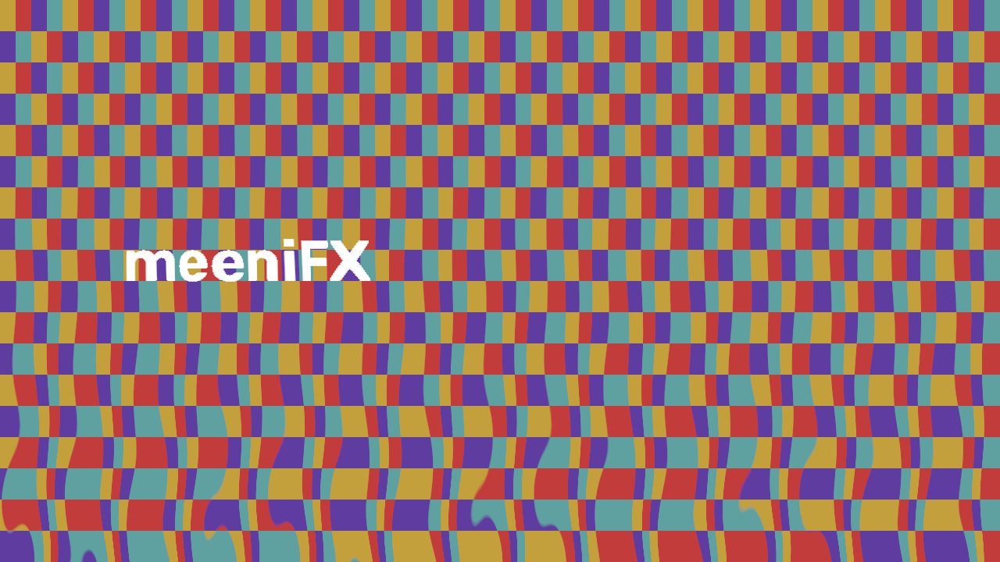
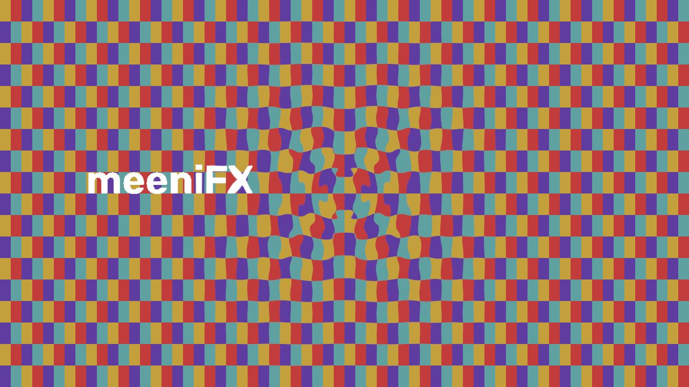
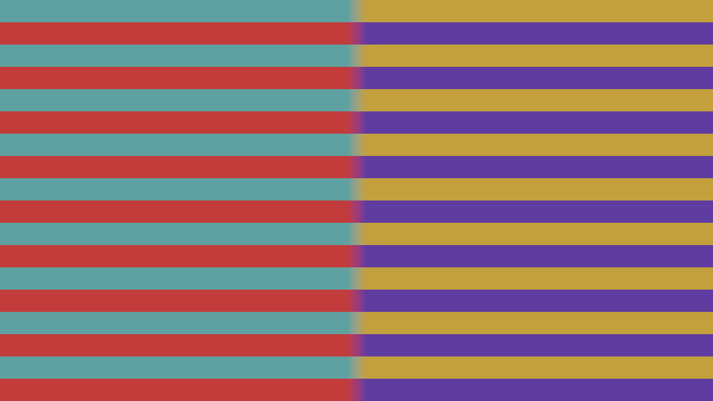
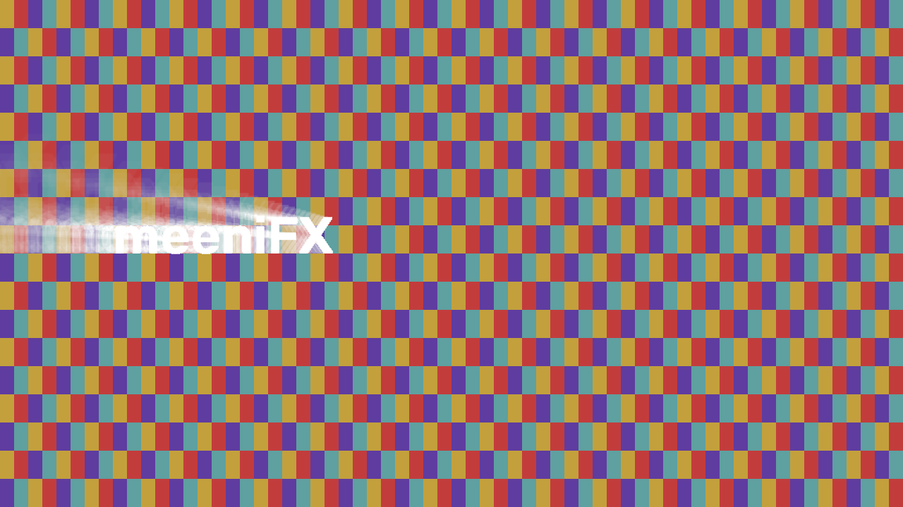

# Shader expansion: Phase 2 development batch

This batch lives on `effects/phase2-shaders`, based on the completed Phase 1 branch.
It is an isolated checkout; the creative-workflow agent's original source tree is
untouched. This is development work, not a published Alpha 10 release or a merge into main.

## Implemented

- **Heat Haze**: animated thermal refraction, wave size, direction, detail, height bias,
  deterministic seed, speed and evolution. Integer temporal harmonics prevent jumps
  when its bounded phase wraps.
- **Ripple**: radial waves with movable origin, signed displacement, wavelength,
  smooth inner/outer falloff, speed and evolution.
- **Pixel Stretch**: adjustable slice position and width, stretch strength and angle.
- **Light Rays**: bright-source radial shafts with origin, intensity, length, threshold,
  falloff, color, screen/add blend and a bounded 8–64 sample quality control.
- **Kaleidoscope**: optional GPU and matching alpha-correct CPU renderers. Its stable
  `kaleidoscope` ID and original CPU rendering remain the default, including projects
  saved without a renderer parameter. Opting into the new renderer changes filtering
  to linear-premultiplied interpolation; this may change edge pixels deliberately.

The four new effects have their own stable IDs, presets, browser metadata, thumbnails
and ordinary keyframe channels. They use the existing project serialization, Looks,
copy/paste, duplication, adjustment and composition paths. There are no downloaded
shaders, copied preset names, or Adobe-specific display prefixes.

## Transfer optimization

The GPU now receives and returns byte BGRA frames. Dedicated shader passes perform
sRGB decode/premultiplication and encode/unpremultiplication on the GPU. CPU fallbacks
retain the same linear-premultiplied algorithms. This reduces each boundary transfer
by 75% (8,294,400 bytes per direction at 1080p instead of 33,177,600).

The worker still owns context creation, compilation, cached programs and reusable
framebuffers; limits account for byte and float textures. Automatic rendering uses
matching CPU fallback on unsupported hardware. Forced GPU reports the driver error.
This batch does not keep an entire effect stack resident on the GPU: each effect
still has one upload and readback. CPU fallback at full resolution can be expensive,
particularly Light Rays; preview scaling and its sample control remain important.

## Measured performance

Windows, Intel UHD Graphics 770, OpenGL 3.3, driver 32.0.101.7077. The table is the
mean of three warm 1920×1080 calls, including upload, conversions and readback.
It measures one effect, not total editor playback. Other local jobs were active.

| Effect | GPU ms | Matching CPU ms |
| --- | ---: | ---: |
| Heat Haze | 15.35 | 701.95 |
| Ripple | 10.68 | 616.59 |
| Pixel Stretch | 10.90 | 591.50 |
| Light Rays (24 samples) | 35.72 | 12828.55 |
| Kaleidoscope (new renderer) | 9.82 | 577.20 |

The transfer change also reduced the previous measured Lens Warp/Page Curl warm
1080p calls from roughly 234/224 ms to 16.64/12.79 ms on this machine. Measurements
are reproducible tools, not performance guarantees for other drivers or timelines.

Raw data: [new effects](benchmarks/shader-phase2.json),
[transfer upgrade](benchmarks/shader-transfer-phase2.json).
CPU memory measurements use a separate tracemalloc render, so timings exclude tracing.

## Render samples

These are actual shader outputs from the synthetic benchmark plate, not editor screenshots.

| Heat Haze | Ripple |
| --- | --- |
|  |  |

| Pixel Stretch | Light Rays |
| --- | --- |
|  |  |

## Verification scope

Focused tests cover CPU/GPU parity at default and boundary settings, transparent input,
invalid numeric values, deterministic seeking, continuous phase wrap, FPS-derived time,
preview scaling, forced-GPU errors and automatic CPU fallback. Legacy Kaleidoscope
projects retain their original rendering path. Integration tests exercise presets,
Looks, project save/reopen, effect copying/duplication, masks, nested compositions,
adjustment layers, generated/text layers and tracked-region effects.

Real PNG, MP4, AVI and GIF exports are decoded and compared with matching preview frames.
PNG is checked below 0.01 mean byte error; lossy formats allow under 10 for codec/palette
conversion. These are small controlled sequences, not a full manual editing session.
Qt tests synthesize events offscreen. They do not verify native mouse interactions,
font availability on other PCs or the complete packaged Windows GUI.

A separately frozen Windows executable checks native ModernGL/glcontext loading,
exact identity output, all seven effect shaders and context cleanup. The portable
build is checked separately for archive integrity and bundled shader resources.
No installer is built locally because Inno Setup is unavailable.

Feedback Center, installer installation/updating, release publication, other effect
phases and the other agent's creative-workflow integration remain outside this batch.
No main-branch merge or release tag is created.

## Development package

The rebuilt portable ZIP contains 333,109,503 bytes. SHA-256:
`30bf3adbb6f09ba00e8bd8d85ce7251fe443850a9d8e6789a0913f8307e4edcc`.
CRC validation, all 12 GLSL/vertex resources byte-for-byte, the application executable,
native GPU modules and ModernGL license presence passed. See
[package checks](benchmarks/shader-phase2-package.json) and
[frozen probe result](benchmarks/shader-phase2-frozen.json).

The full packaged editor was not launched or manually operated. This portable replaces
the earlier development ZIP in this checkout; it has not been uploaded as a release.

## Final automated results

2223 pytest checks passed, 92 skipped, zero failures; both standalone project/storage assertion scripts also passed.
110 modules/scripts were checked in fresh processes with private Qt settings.
The broad run initially skipped four hand-landmark checks because its model path
was unset; all four passed in a focused run using the existing local model.
The remaining skips cover explicitly separate parameter contexts and unavailable
recording conditions. See [module results](benchmarks/shader-phase2-tests.json).

Reproduce with `python tools/run_tests.py --output artifacts/phase2-tests`.
Native GUI interaction and installer behavior remain untested.
